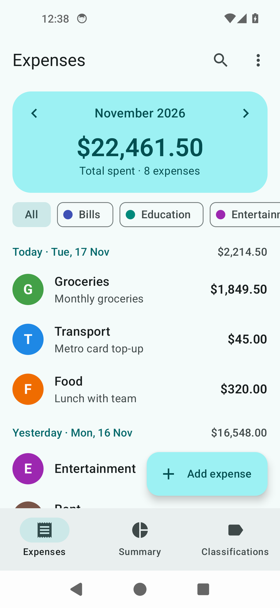
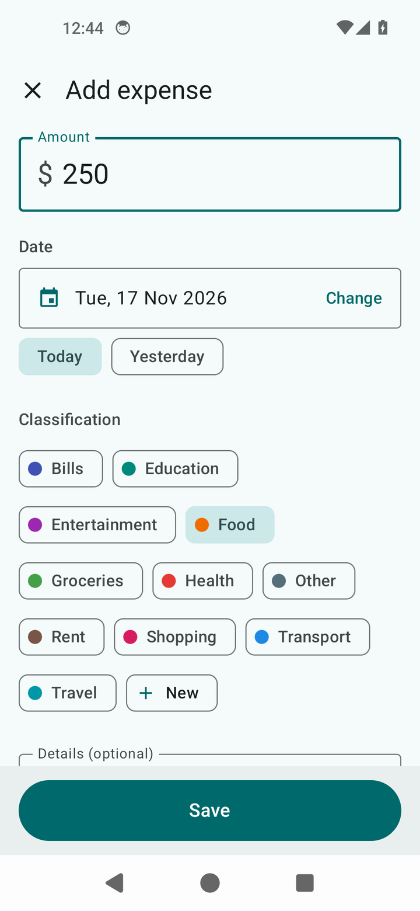
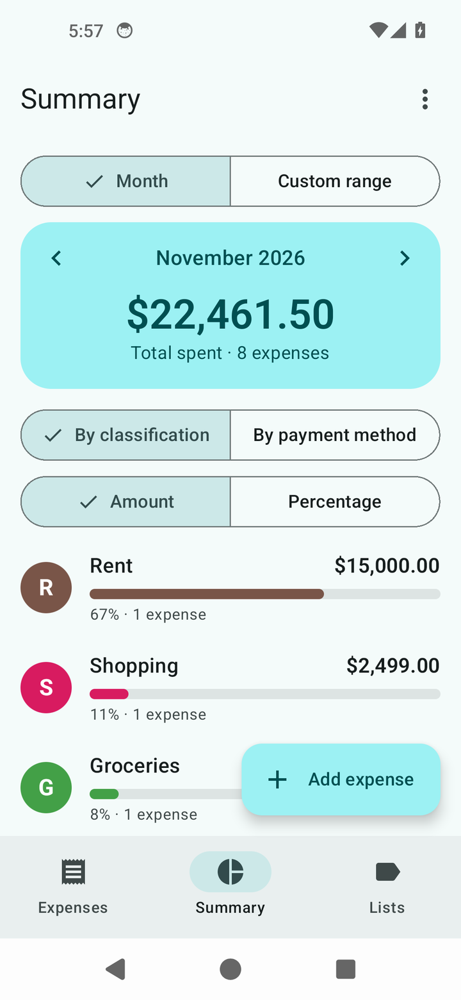
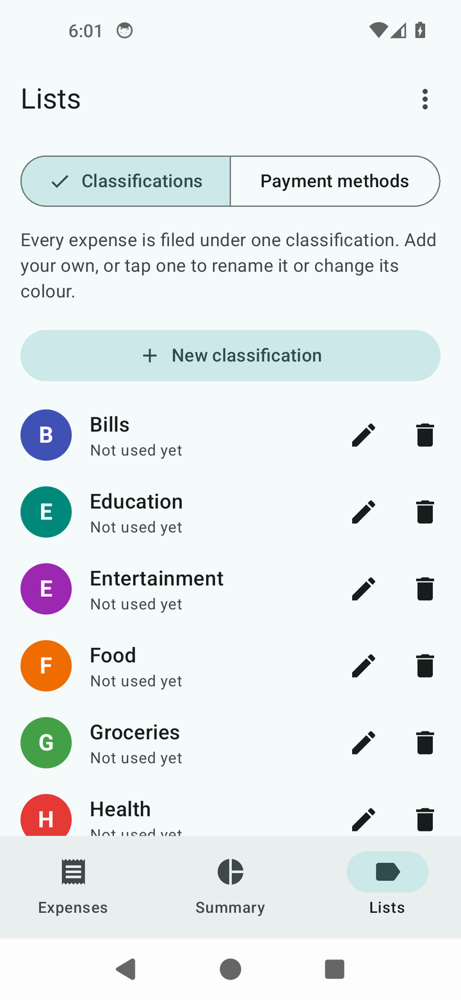

# Expense Tracker

A small, fast Android app for recording what you spend. Everything is stored on
the phone; the app needs no account, no internet and no permissions.

| Expenses | Add an expense | Summary | Classifications |
| --- | --- | --- | --- |
|  |  |  |  |

## Install

1. On the phone, download [`apk/ExpenseTracker.apk`](apk/ExpenseTracker.apk)
   (open the file on GitHub and tap **Download raw file**).
2. Open the downloaded file. Android asks once to allow installs from the app
   you opened it with (browser or file manager): allow it, then tap **Install**.

Needs Android 8.0 or newer. Installing a newer APK over an older one keeps your
expenses, because every build is signed with the same key.

## Using it

- **Add an expense**: tap **Add expense**, type the amount, pick the date
  (today by default), choose a classification, and optionally write details.
- **Change or delete**: tap an expense in the list.
- **Months**: the arrows at the top move between months; tap the month name to
  jump back to the current month.
- **Filter**: the chips under the total show one classification at a time.
- **Search**: the magnifier searches every month at once. Type part of the
  details, a classification, an amount (`250`) or a date (`16 nov`). Several
  words narrow the result.
- **Summary**: the middle tab totals the month by classification. Tap a row to
  see those expenses.
- **Classifications**: the last tab is the list you choose from when adding an
  expense. Add your own, rename them, change their colour or delete them.
  Deleting a classification keeps its expenses; they show as *Uncategorized*.
- **⋮ menu**
  - **Export to CSV file** saves all expenses to a file that opens in Excel or
    Google Sheets. It is also your backup.
  - **Import from CSV file** reads such a file back. Expenses already in the
    app are skipped, so importing the same file twice is harmless.
  - **Currency** picks the symbol amounts are shown with (by default it follows
    the phone's region).

## For developers

Kotlin, Jetpack Compose and Room (SQLite). The release build is shrunk with R8.

```
./gradlew testDebugUnitTest        # unit tests of the logic in core/
./gradlew assembleRelease          # app/build/outputs/apk/release/app-release.apk
./gradlew connectedDebugAndroidTest  # on-device tests, needs a phone or emulator
```

Every push runs all three on GitHub Actions (`.github/workflows/build-apk.yml`),
the last one on an emulator. Running that workflow manually with **publish**
ticked commits the tested APK to `apk/` and fresh screenshots to
`docs/screenshots/`.

Code layout, under `app/src/main/java/.../expensetracker/`:

- `core/` – plain Kotlin with no Android imports: money parsing and formatting,
  search, CSV, monthly summaries, classification rules.
- `data/` – Room database (expenses and classifications) and the repository.
- `ui/` – Compose screens and the view model.

The signing key in `signing/` is deliberately public so that builds made
anywhere can update each other. Replace it with a private key before publishing
the app to a store.
